

  
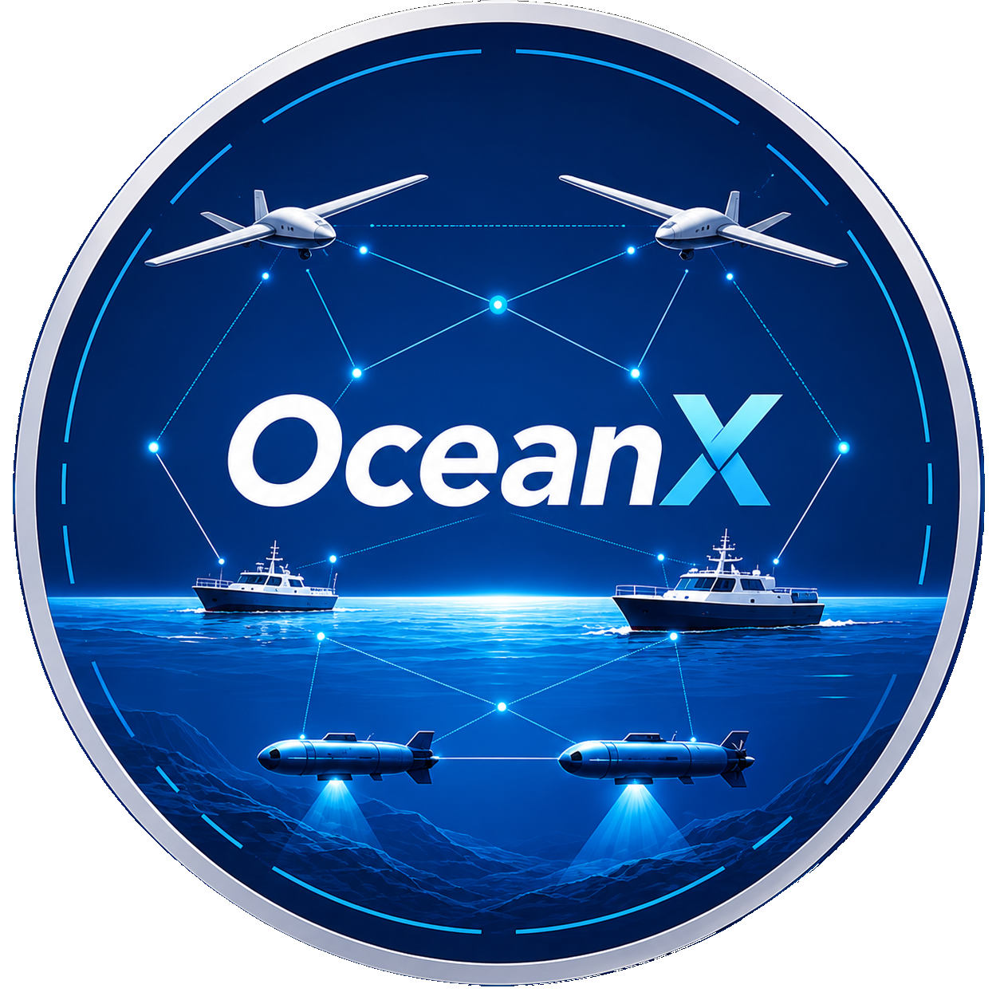

  <h1>OceanX</h1>
  
<strong>Multi-vehicle simulation for marine and cross-domain autonomy</strong>

  
Underwater · Surface · Air · Ground

  
Configure a world. Run closed-loop control. Observe sensors. Replay the experiment.

  

    
    
    
    
    
    
  

  

    <a href="#meet-oceanx">Overview</a> ·
    <a href="#cross-domain-marine-autonomy">Rendering</a> ·
    <a href="#world-terrain">World Terrain</a> ·
    <a href="#sensor-gallery">Sensors</a> ·
    <a href="#vehicle-gallery">Vehicles</a> ·
    <a href="#getting-started">Get Started</a>
  

  <a href="docs/assets/readme/rendering/surface-air-fleet.png">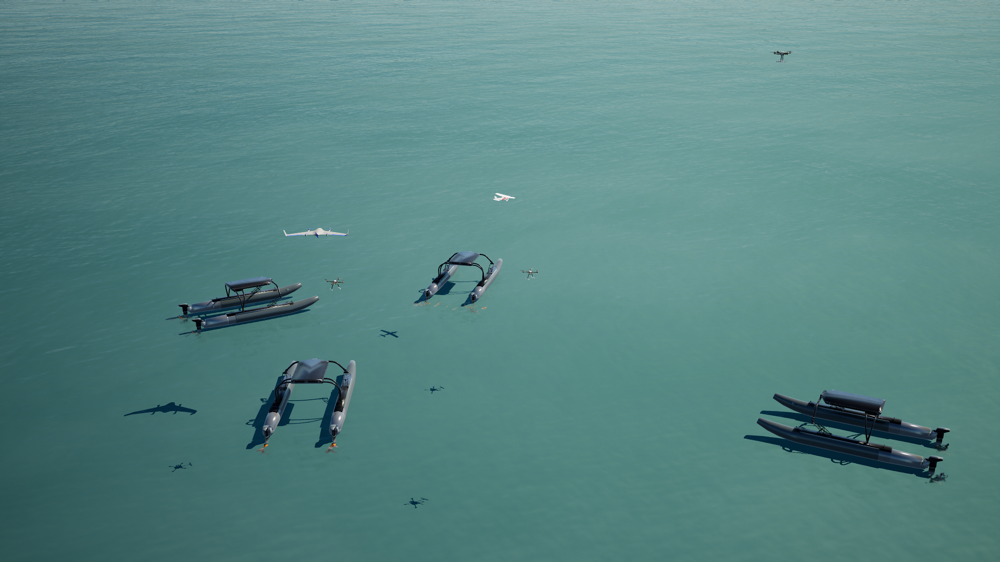</a> 
  One marine world, multiple vehicle domains.

> [!NOTE]
> OceanX is under active development. This repository presents the current implementation; public distribution details will be added when ready. The gallery uses real simulation captures from November 2026. Click any scene or sensor image to view the original.

## Meet OceanX

OceanX brings 3D environments, vehicle dynamics, autopilot control, sensors, and experiment tools into one simulation workspace. Evaluate a single underwater robot or combine AUVs, ROVs, surface vessels, aircraft, and ground vehicles in a shared scenario.

OceanX provides the environment, dynamics, sensors, and visualization. HydroX handles navigation estimation, guidance, control, and actuator allocation. ROS 2 connects external tasks and algorithms. In software-in-the-loop mode, each controlled vehicle runs an independent HydroX instance.

| Capability | What you can do |
|---|---|
| Marine rendering | Observe sea-surface reflections, underwater lighting, seabed materials, terrain, and vehicle shadows |
| Multi-domain scenarios | Combine underwater, surface, aerial, and ground platforms in one vehicle group |
| World terrain | Pick a location on a globe and load offline land and seafloor terrain around cameras and vehicles |
| Closed-loop control | Run HydroX in SITL or connect a physical autopilot through HITL |
| Environment configuration | Select maps independently of vehicle groups; configure current, wind, water, and scene-object positions |
| Sensor observation | Inspect optical images, sonar, bathymetry, and LiDAR point clouds |
| External algorithms | Run supervisory programs and exchange state and commands through ROS 2 topics |
| Experiment capture | Save images, record and replay simulation states, and associate ROS bags and controller logs |

## Cross-Domain Marine Autonomy

**Underwater robots, surface vessels, and aircraft share the same ocean environment.** The current rendering brings together the sea surface, underwater visibility, illuminated vehicle models, and textured seabed terrain. Free and follow cameras let you inspect the scene independently of each vehicle's onboard sensors.

### Underwater · AUVs & ROVs

  <a href="docs/assets/readme/rendering/underwater-fleet.png">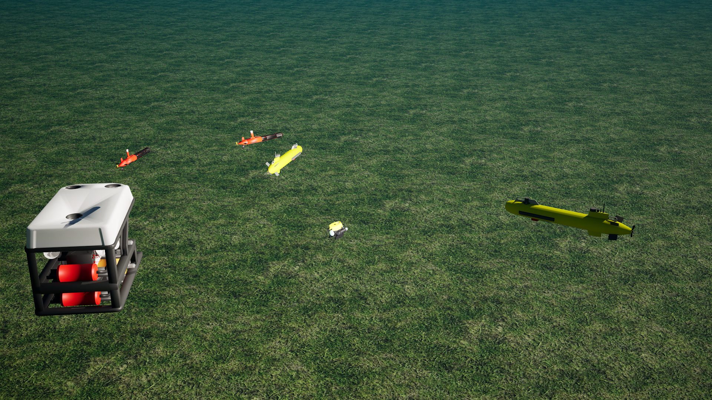</a> 
  External scene view of the underwater formation, with the camera carrier on the right.

The surface view above and this underwater view use the same three-domain optical fleet in `IntegratedScene`. This static showcase contains underwater vehicles, WAM-V vessels, multirotors, a fixed-wing aircraft, and a VTOL aircraft. Its three onboard cameras provide the independent sensor frames below.

| Domain | Example platforms | Experiment focus |
|---|---|---|
| Underwater | ECA A9, LAUV, Desistek SAGA, RexROV2 | Depth control, underwater dynamics, optical and acoustic sensing |
| Surface | VRX WAM-V | Surface motion, heading, currents, and sea-surface observations |
| Air | X500, RC Cessna, Standard VTOL | Aircraft state, aerial sensing, and wind disturbances |
| Ground | R1 Rover | Ground motion and terrain interaction |

The captures demonstrate scene composition and sensor output. Motion and cooperative behavior are supplied by the selected controllers and task programs.

### Lighting, Water & Optical Cameras

The current scene launch profile configures Unreal Engine 5.3's Lumen lighting and reflections. Sea-surface materials and underwater post-processing are shared with the optical camera color capture, keeping onboard views consistent with the rendered environment. Cameras retain their own mounts, fields of view, exposure settings, and detector effects.

Choose **High Quality**, **Ultra**, or **Cinematic** in Preferences to set the graphics budget for your hardware. Sensor resolution is configured separately in the vehicle profile.

## World Terrain

**Choose a place on the globe and explore its land and seafloor.** World Terrain uses offline NOAA ETOPO 2022 elevation data. Local terrain loads around the camera and active vehicles, with collision and sensor-query coverage maintained as the region expands. Its surface materials, ocean, lighting, and fog follow the integrated scene's visual setup.

Select **World scene** and the empty **World scene exploration** group to browse, or use a vehicle group with starting positions suited to the selected location. The source elevation grid is 15 arc-seconds; terrain materials are illustrative, and sub-grid coastline or harbor detail may be absent. The scene uses a local planar projection.

The gallery on this page was captured in the authored `IntegratedScene` environment. World Terrain provides a separate geographic workflow.

## Sensor Gallery

**Optical frames and sonar panels from the simulator.** The sonar views preserve the original scales, status, and echo intensities.

### Optical · Underwater, Surface & Air

  <strong>Underwater Camera · AUV</strong> 
  <a href="docs/assets/readme/rendering/underwater-camera.png">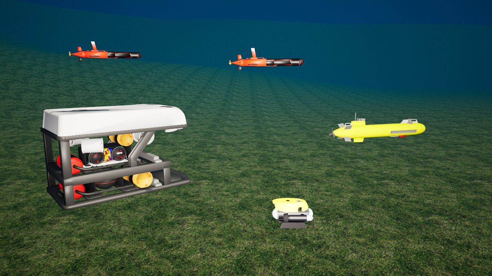</a> 
  Illuminated close-range observation of the underwater formation.

<table>
  <tr>
    <td align="center" valign="top"><strong>Surface Camera · USV</strong> <a href="docs/assets/readme/rendering/surface-camera.png">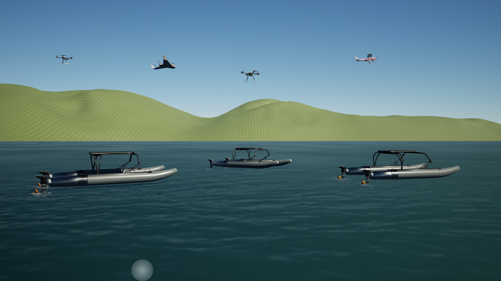</a> Vessel-mounted view across the waterline.</td>
    <td align="center" valign="top"><strong>Air Camera · UAV</strong> <a href="docs/assets/readme/rendering/air-camera.png">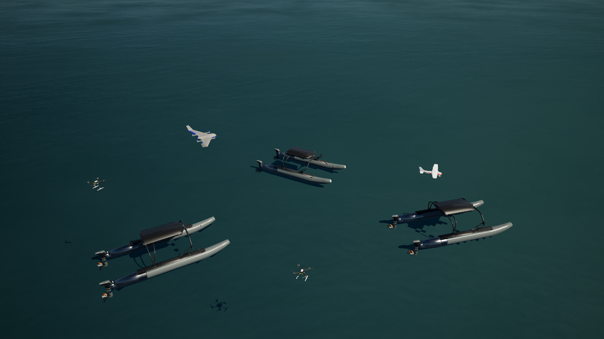</a> Elevated view of the same surface and airborne group.</td>
  </tr>
</table>

These are independently sampled frames from the same static fleet, using the common `OpticalImagerSensor` pipeline. Each illustrated camera is configured for 20 Hz. The three frames are independent samples rather than simultaneous exposures. Their configured rate is not a measured throughput claim; see the [capture notes](docs/assets/readme/SCREENSHOTS.md).

### Acoustic · Scene Geometry & Echoes

  <a href="docs/assets/readme/rendering/sonar-scene.png">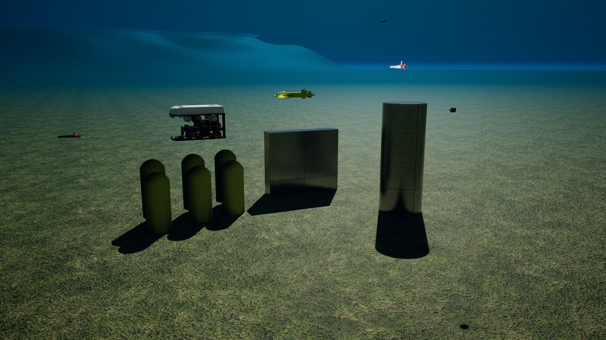</a> 
  Vehicle and obstacle geometry in the acoustic showcase.

<table>
  <tr>
    <td align="center" valign="top"><strong>Forward-Looking Imaging Sonar</strong> <a href="docs/assets/readme/rendering/forward-looking-sonar.png">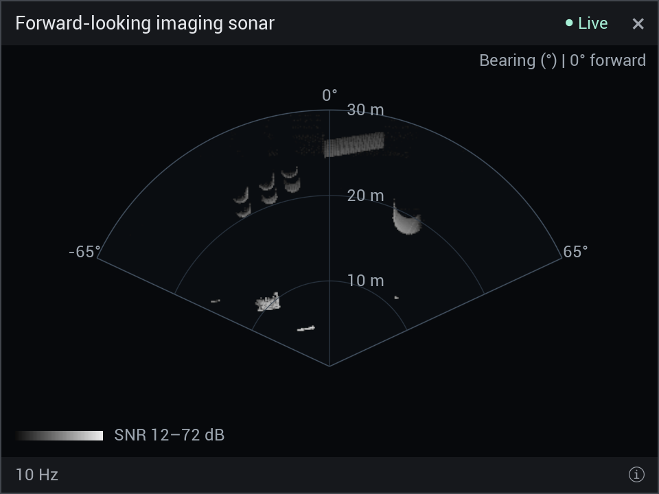</a> Echo intensity over slant range and bearing.</td>
    <td align="center" valign="top"><strong>Mechanical Scanning Imaging Sonar</strong> <a href="docs/assets/readme/rendering/mechanical-scanning-sonar.png">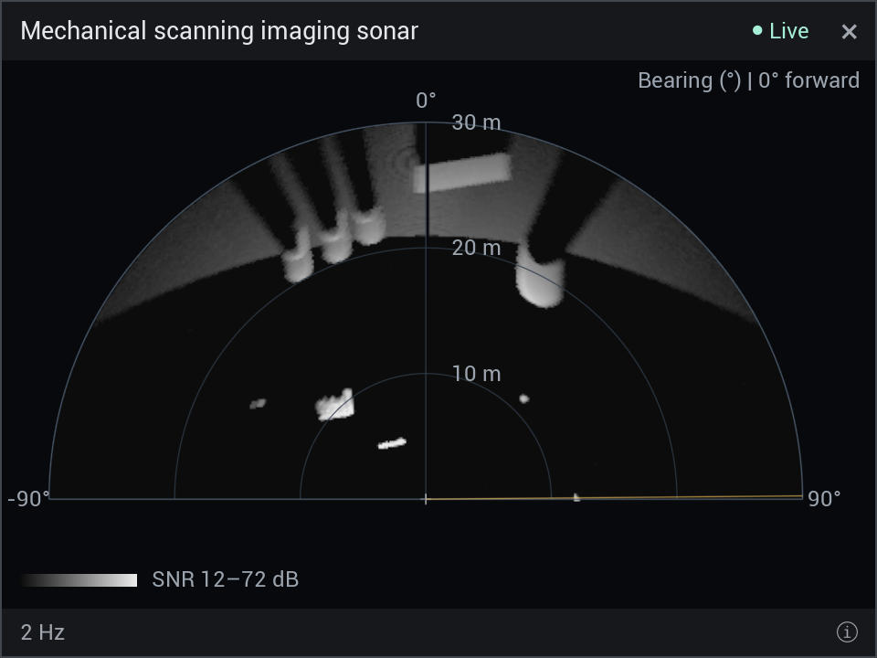</a> Successive pings accumulate a sector scan.</td>
  </tr>
  <tr>
    <td colspan="2" align="center"><strong>Side-Scan Sonar</strong> <a href="docs/assets/readme/rendering/side-scan-sonar.png">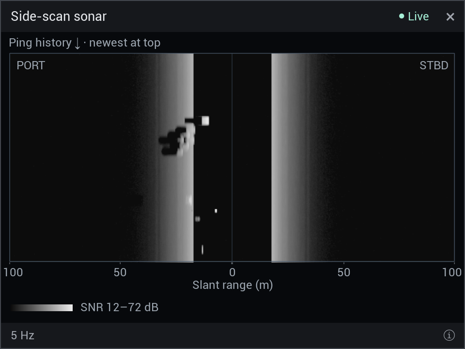</a> Port and starboard returns during a moving survey pass; newest ping at the top.</td>
  </tr>
</table>

The acoustic views use the same acoustic comparison scene. Forward-looking and mechanical scans observe fixed targets; the side-scan history comes from a separate moving carrier. Their capture times and sampling patterns differ. The [capture notes](docs/assets/readme/SCREENSHOTS.md) describe the source of each image.

### Imaging & Ranging Catalog

| Sensor | Output |
|---|---|
| Optical imager | Camera frames from underwater, surface, and aerial mounts |
| Forward-looking imaging sonar | Echo intensity over slant range and bearing |
| Mechanical scanning imaging sonar | A sector accumulated from successive pings |
| Side-scan sonar | Port and starboard echo-history waterfall |
| Multibeam echosounder | Across-track and downward coordinates of valid returns |
| Sub-bottom profiler | Echo history against two-way travel time |
| Echo sounder | Single-beam range history |
| Rotating LiDAR | 3D returns and intensity |
| Semantic LiDAR | 3D returns with simulation ground-truth class and instance labels |

LiDAR includes water-surface occlusion and a near-infrared surface-return approximation; it does not simulate underwater laser transmission. Semantic labels come from the configured scene.

## Control & Interfaces

Use **Data & Interfaces** to inspect control links, run supervisory programs, and browse ROS 2 topics. External algorithms can consume state and publish task commands through the existing ROS interfaces.

| Interface | Purpose |
|---|---|
| HydroX SITL | Independent navigation and control instance for each controlled vehicle |
| MAVLink HITL | Connect supported physical autopilot benches to simulated vehicles |
| ROS 2 topics | Exchange vehicle state and commands; inspect message rates and fields |
| Supervisory programs | Launch deployed Python tasks, configure arguments, and read their output |
| Communication diagnostics | Inspect configured inter-vehicle links and communication state |

The current HITL path targets Pixhawk / FMUv6C benches. TELEM1 carries the main HIL connection; TELEM2 provides the separate control-command connection. Hardware readiness and vehicle compatibility are checked before launch.

## Interface Tour

The workspace follows an experiment from setup to observation and replay.

| Page | What you can do |
|---|---|
| Start Simulation / Simulation & Vehicles | Select an environment and vehicle group; edit initial positions; start, pause, or soft-reset a run |
| Environment | Configure current and wind fields, sea level, water, terrain, and scene-object positions |
| Data & Interfaces | Inspect SITL/HITL links, launch task programs, browse ROS topics, and inspect communication |
| Views & Layout | Use free or follow cameras; choose sensor feeds, telemetry, maps, and trails |
| Capture & Replay | Capture views, record an experiment, browse recordings, seek, and change playback speed |
| Preferences | Adjust camera response, graphics quality, and English / Simplified Chinese UI language |
| Shortcuts | Look up simulation, camera, sensor, and recording controls |

`Esc` opens the menu while the simulation continues; `Space` pauses or resumes. Use `Tab` / `Shift+Tab` to change vehicle and `3` to toggle sensor feeds. `F9` captures the viewport, `Ctrl+F9` exports a view set, and `F10` starts or stops recording.

Replay stores simulation states; rosbag stores ROS messages; HydroX XLog stores controller diagnostics.

## Vehicle Gallery

The current vehicle catalog spans underwater, surface, aerial, and ground platforms. Combine models in a vehicle group and configure sensors and control parameters for each instance.

<table>
  <tr>
    <td align="center">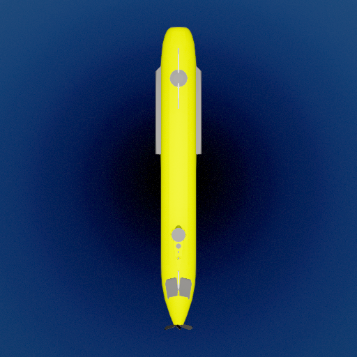 <strong>ECA A9</strong> AUV</td>
    <td align="center">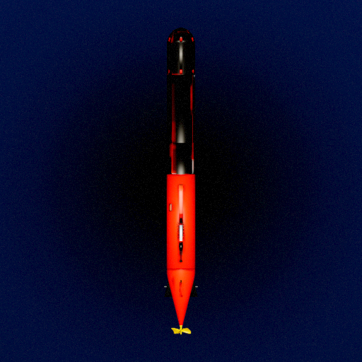 <strong>LAUV</strong> AUV</td>
    <td align="center">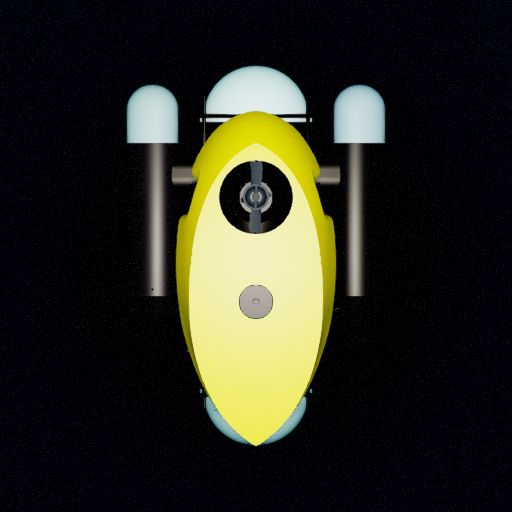 <strong>Desistek SAGA</strong> ROV</td>
  </tr>
  <tr>
    <td align="center">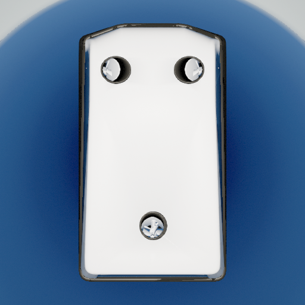 <strong>RexROV2</strong> ROV</td>
    <td align="center">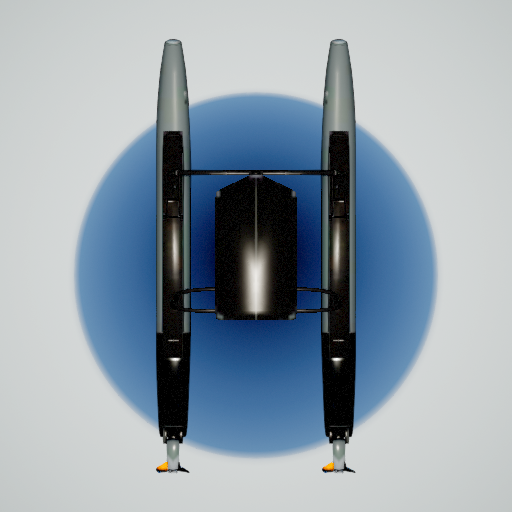 <strong>VRX WAM-V</strong> USV</td>
    <td align="center">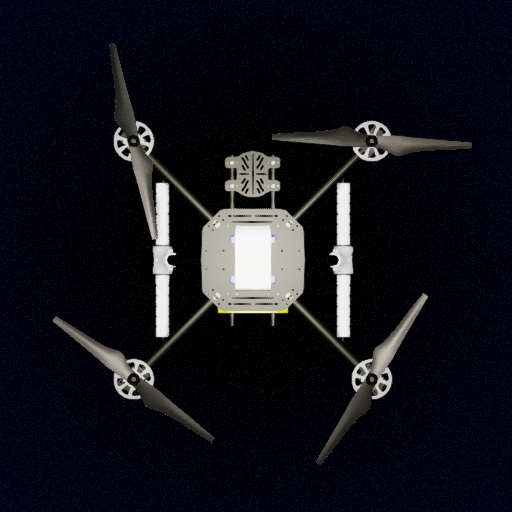 <strong>X500</strong> Multirotor UAV</td>
  </tr>
  <tr>
    <td align="center">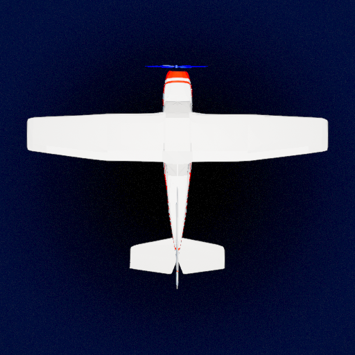 <strong>RC Cessna</strong> Fixed-wing UAV</td>
    <td align="center">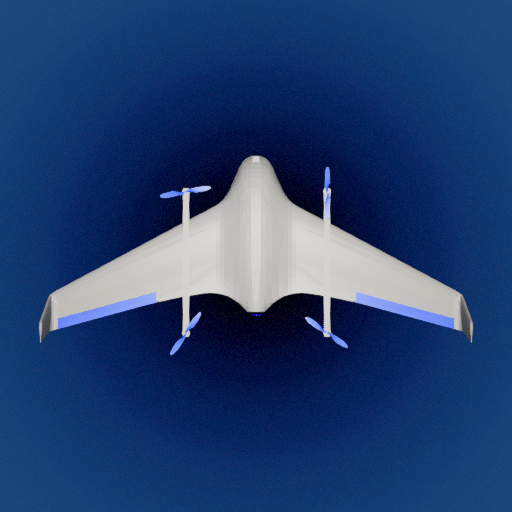 <strong>Standard VTOL</strong> VTOL UAV</td>
    <td align="center">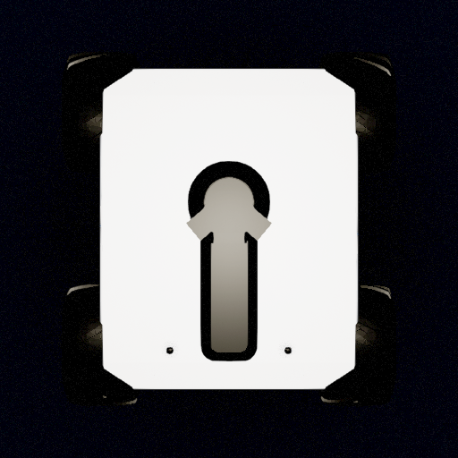 <strong>R1 Rover</strong> UGV</td>
  </tr>
</table>

## Getting Started

In an installed OceanX runtime, select an environment and vehicle group before starting. The illustrated optical and acoustic showcases use `IntegratedScene`; **World scene** with **World scene exploration** opens the geographic browsing workflow.

Environment selection and vehicle-group selection are independent. Check initial positions against the chosen terrain and water depth before running a motion task.

1. **Prepare.** Select the environment, vehicle group, sensor profiles, and initial positions.
2. **Configure.** Set current and wind conditions; verify SITL or HITL control links.
3. **Run.** Start the simulation and the chosen supervisory program or ROS 2 task.
4. **Observe.** Follow a vehicle, inspect sensor frames, and monitor state and topics.
5. **Review.** Save captures and recordings, then replay the experiment alongside its logs.

## Platform & Availability

- **Windows / Win64:** primary development and validation platform; standalone runtime packaging is implemented.
- **ROS 2:** external control and topic inspection require a compatible runtime and project interfaces.
- **HITL:** software links and bench tools are implemented; hardware qualification remains device-specific.
- **Linux:** no prebuilt runtime is currently available.

Image sources and capture notes are recorded in [SCREENSHOTS.md](docs/assets/readme/SCREENSHOTS.md).

## License

OceanX's own core uses a proprietary license. Unreal Engine, Oceanology, vehicle models, and other third-party components retain their respective licenses and copyright terms. Use and redistribution are governed by the terms supplied with the relevant deliverable.
